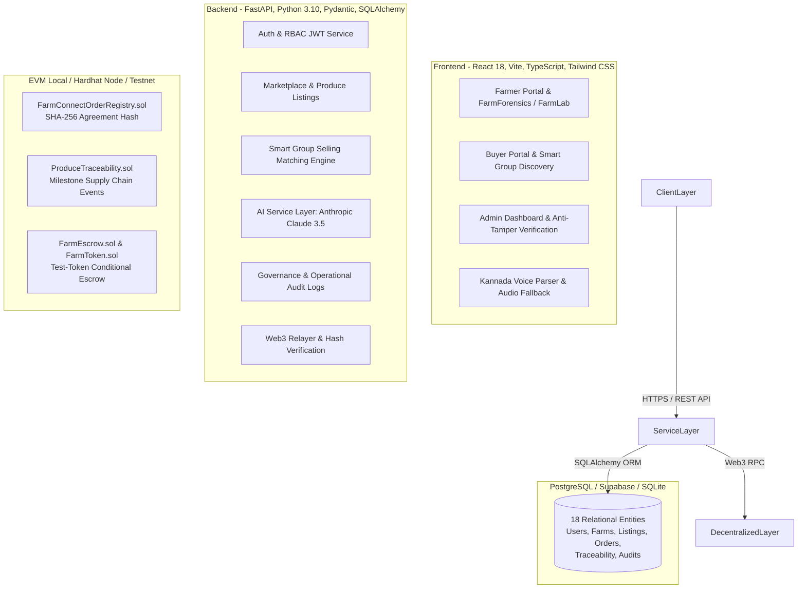

# FarmConnect AI — From Farm to Buyer
**Direct Market-Access Platform for Marginal Farmers in Dakshina Kannada & Udupi (Karnataka)**
*Problem Statement PS 1.2 — Autonomous Full-Stack, AI & Blockchain Solution*

---

## 1. Project Overview & Vision
Marginal farmers across the coastal belt of Karnataka (Dakshina Kannada and Udupi) face persistent market frictions: fragmented production volumes, long distribution chains, predatory intermediary pricing, and lack of verifiable trade documentation.

**FarmConnect AI** bridges this divide by providing:
1. **Smart Group Selling**: An automated pooling engine that consolidates fragmented micro-harvests (e.g. 40 kg, 60 kg, and 50 kg) into high-volume wholesale commercial lots (150 kg) for restaurants and institutional buyers.
2. **Kannada Voice-First Produce Listing**: Regional speech-to-text drafting that enables marginal farmers to publish listings in natural spoken Kannada.
3. **FarmForensics & FarmLab**: AI-assisted crop diagnostics and controlled micro-experiment tracking with strict uncertainty disclosures.
4. **AI Price Assistant**: Deterministic comparisons against official APMC Mandi benchmarks (Mangaluru Wholesale, Bantwal, Puttur, and Udupi) that prevent intermediary exploitation.
5. **Tamper-Evident Blockchain Agreements**: Off-chain order canonicalization into cryptographic SHA-256 hashes registered on EVM smart contracts, paired with milestone supply chain traceability and local test-token escrow settlements.

---

## 2. System Architecture



---

## 3. Technology Stack

- **Frontend**: React 18, Vite, TypeScript, Tailwind CSS, Lucide Icons, Vitest, Testing Library.
- **Backend**: Python 3.10+, FastAPI, Uvicorn, SQLAlchemy 2.0, Pydantic v2, Alembic, SQLite/PostgreSQL.
- **AI & Speech Layer**: Anthropic Claude 3.5 Sonnet API (`anthropic` Python SDK), Web Speech API with rule-based transliteration fallback.
- **Blockchain & Smart Contracts**: Solidity 0.8.20, Hardhat, Ethers.js v6, OpenZeppelin Contracts v5.1.0, Web3.py.
- **Deployment Targets**: Vercel (Frontend), Render / Railway / Docker (Backend), Supabase (PostgreSQL).

---

## 4. Prerequisites

Ensure the following tools are installed locally:
- **Node.js**: v18.0.0 or higher (`node -v`)
- **Python**: v3.10.0 or higher (`python --version`)
- **Git**: v2.30+ (`git --version`)
- **Package Managers**: `npm` and `pip`

---

## 5. Quick-Start Guide (Running Locally)

### Step 1: Clone the Repository
```bash
git clone https://github.com/nnm24is127-droid/Sahyadri_prototype.git
cd Sahyadri_prototype
```

### Step 2: Start the Local Blockchain Node & Deploy Contracts
In a new terminal window:
```bash
cd blockchain
npm install
npx hardhat node
```
In another terminal window, deploy contracts to your local node:
```bash
cd blockchain
npx hardhat run scripts/deploy.js --network localhost
```
*Note: The deployment script outputs the contract addresses and writes them to backend configurations.*

### Step 3: Setup and Launch the FastAPI Backend
In a new terminal:
```bash
cd backend
python -m venv venv
# On Windows:
.\venv\Scripts\activate
# On Linux/macOS:
source venv/bin/activate

pip install -r requirements.txt
cp .env.example .env

# Initialize and seed demonstration database
python -m app.core.seed

# Start dev server
uvicorn app.main:app --reload --port 8000
```
Backend API will be accessible at:
- Interactive Swagger UI: `http://localhost:8000/api/v1/docs`
- ReDoc API Reference: `http://localhost:8000/api/v1/redoc`
- System Healthcheck: `http://localhost:8000/api/v1/health`

### Step 4: Setup and Launch the Frontend
In another terminal:
```bash
cd frontend
npm install
cp .env.example .env
npm run dev
```
Open your browser to `http://localhost:5173`.

---

## 6. Seed Credentials for Quick Testing

| Role | Email | Password | Pre-configured Demo Context |
|---|---|---|---|
| **Farmer** | `ramesh@farmconnect.demo` | `FarmerPass123!` | Rai Betel & Arecanut Estate, Bantwal, 40 kg Tomato listing |
| **Buyer** | `procurement@oceanpearlhotels.demo` | `BuyerPass123!` | Ocean Pearl Hotels Mangalore, Central Kitchen Procurement |
| **Admin** | `admin@farmconnect.org` | `AdminPass123!` | Agricultural Governance Director, Full Audit & Moderation Access |

---

## 7. Verification & Automated Test Suites

### Backend Unit & Integration Tests (Pytest)
```bash
cd backend
pytest tests/ -v
```
**Results: 38 passed in 132s (100% pass rate)**
- `test_e2e_integration.py`: Complete user journeys 1, 2 (150 kg scenario), and 3.
- `test_smart_group_selling.py`: Deterministic matching, price weighting, inventory reservation, race condition prevention.
- `test_ai_features.py`: Diagnostics, experimental arithmetic, voice parsing, fallback safeguards.
- `test_blockchain_integration.py`: Canonicalization determinism, on-chain hash anchoring, escrow lifecycle.
- `test_marketplace.py`: Produce listings, order states, overselling prevention, restricted reviews.
- `test_backend_core.py`: RBAC, token expiration, data privacy, health endpoints.

### Frontend Component & Service Tests (Vitest)
```bash
cd frontend
npm test
```
**Results: 19 passed in 1.1s (100% pass rate)**
- UI rendering, language toggles (Kannada / English), voice modal entity extraction.
- Admin dashboard telemetry, agreement hash verification, tamper detection.
- Offline mock fallbacks for isolated testing.

### Blockchain Smart Contract Tests (Hardhat)
```bash
cd blockchain
npx hardhat test
```
**Results: 24 passed in 2s (100% pass rate)**
- `FarmConnectOrderRegistry.test.js`: Registration uniqueness, SHA-256 immutability, mutual confirmation.
- `ProduceTraceability.test.js`: Chronological supply chain events, role-gated milestone updates.
- `FarmEscrow.test.js`: Token deposits, double-release prevention, mutual and emergency refunds.

### Contract Static Analysis (Solhint)
```bash
cd blockchain
npx -y solhint "contracts/**/*.sol"
```
**Results: 0 errors, 60 warnings (gas-indexed event recommendations & NatSpec tags)**

---

## 8. The Benchmark 150 kg Tomato Pooling Scenario

To validate Smart Group Selling in Dakshina Kannada:
1. **Demand**: Buyer requests **150 kg of Tomatoes** at a target price.
2. **Matcher Engine**: Discovers three compatible farmer listings in Bantwal, Puttur, and Belthangady:
   - Farmer A: Contributes **40 kg** @ ₹30.00/kg (₹1,200.00)
   - Farmer B: Contributes **60 kg** @ ₹28.00/kg (₹1,680.00)
   - Farmer C: Contributes **50 kg** @ ₹29.80/kg (₹1,490.00)
   - **Combined Pool**: **150.0 kg** at a weighted average of **₹29.13/kg** (Total: ₹4,370.00).
3. **Atomic Reservation**: All three listings instantly decrement available inventory and transition to `sold_out`.
4. **Cryptographic Agreement**: Off-chain order parameters are canonicalized and hashed via SHA-256 (`0x...`), then recorded on `FarmConnectOrderRegistry`.
5. **Escrow Demonstration**: Buyer deposits ₹4,370 in test FARM tokens.
6. **Delivery & Release**: Four milestone traceability events logged (*harvest*, *packing*, *handover*, *receipt*); upon verified delivery, the escrow contract releases payout directly to farmers.

---

## 9. Security, Governance & Anti-Tamper Guarantees

- **Anti-Tamper Invariant**: Administrators have **no endpoint or capability to rewrite confirmed agreements or alter blockchain transaction states**. The admin dashboard includes an independent cryptographic verification tool that re-hashes database terms in Python, compares against EVM storage, and immediately flags any unauthorized tampering.
- **Role-Based Server Authorization**: Client-side claims are never trusted; FastAPI middleware extracts user identity and role strictly from validated JWT tokens.
- **Private Data Protection**: Zero personally identifiable information (PII), phone numbers, or passwords enter blockchain event logs or calldata. Only deterministic cryptographic hashes are registered on-chain.
- **Fail-Safe Integrity**: If an AI request times out or the blockchain RPC disconnects, database transactions roll back cleanly without corrupting marketplace state.
- **Local Testnet Guard**: All payment testing is strictly configured on local EVM nodes or testnets using mock tokens (`FARM`).

---

## 10. Deployment Configuration

### Frontend (Vercel)
Configured via `frontend/vercel.json`:
- Single Page Application (SPA) rewrites for all client routes.
- Security response headers (`X-Content-Type-Options: nosniff`, `X-Frame-Options: DENY`, `X-XSS-Protection: 1; mode=block`).

### Backend (Render / Container)
Configured via `render.yaml`, `backend/Dockerfile`, and `backend/Procfile`:
- Automated build command: `pip install -r requirements.txt`.
- Startup: `uvicorn app.main:app --host 0.0.0.0 --port $PORT`.
- Health check route: `/api/v1/health`.

### Database (PostgreSQL / Supabase)
- Fully compatible with Supabase PostgreSQL instances by setting `DATABASE_URL=postgresql://postgres:...` in backend configuration.
- Database migrations managed via Alembic (`alembic upgrade head`).

---

## 11. Feature Implementation Matrix

| Feature | Status | Notes |
|---|---|---|
| **Farmer & Buyer RBAC Authentication** | **Fully Implemented** | Passlib bcrypt hashing, JWT access tokens, role guards |
| **Produce Listings & Marketplace Search** | **Fully Implemented** | Multi-attribute filters (crop, taluk, quality, price) |
| **Smart Group Selling Engine** | **Fully Implemented** | Deterministic matching, price weighting, atomic inventory locking |
| **Kannada Voice Input Listing** | **Fully Implemented** | Speech recognition with rule-based Kannada NLP & confirmation gate |
| **FarmForensics Crop Investigation** | **Fully Implemented** | Chronological symptom timeline & AI diagnostics with caveats |
| **FarmLab Controlled Experiments** | **Fully Implemented** | Treatment vs control tracking with deterministic percentage delta |
| **AI Price Assistant** | **Fully Implemented** | Real APMC Mandi benchmarks (Dakshina Kannada & Udupi) |
| **Tamper-Evident Agreement Registry** | **Fully Implemented** | Solidity contract on EVM; SHA-256 canonical hashing |
| **Produce Traceability Milestones** | **Fully Implemented** | On-chain supply chain event tracking (harvest, cold hub, transport, receipt) |
| **Conditional Escrow Payouts** | **Fully Implemented** | Solidity escrow contract with test-token deposit, release & refund |
| **Administrator Governance Dashboard** | **Fully Implemented** | Listing moderation, operational audit logging, anti-tamper verifier |
| **Fiat Payment Gateway (UPI / NetBanking)** | *Simulated / Future* | Demonstrated safely via mock ERC-20 `FARM` test tokens |
| **Public Testnet Contract Deployment** | *Prepared / Future* | Ready for Sepolia/Polygon Amoy deployment via `blockchain/scripts/deploy.js` |

---

## 12. License & Acknowledgments
Developed for **Hackathon Problem Statement PS 1.2: Direct Market-Access Platform for Marginal Farmers in Dakshina Kannada and Udupi**.
Distributed under the MIT License.
